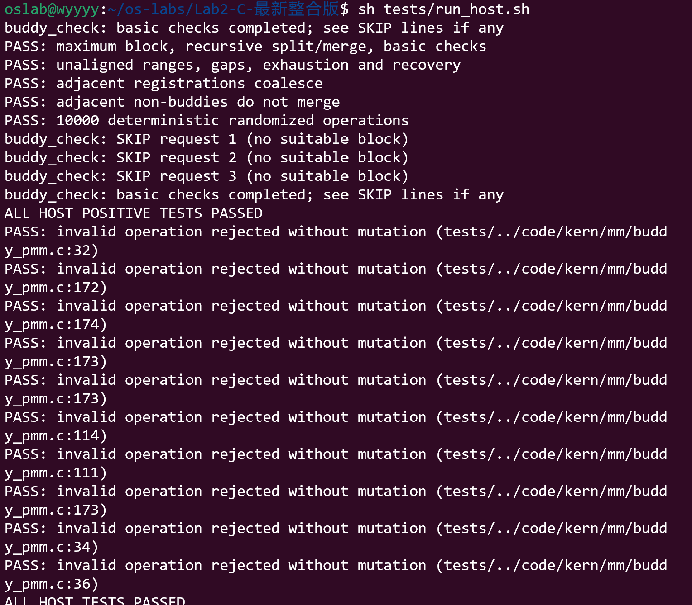
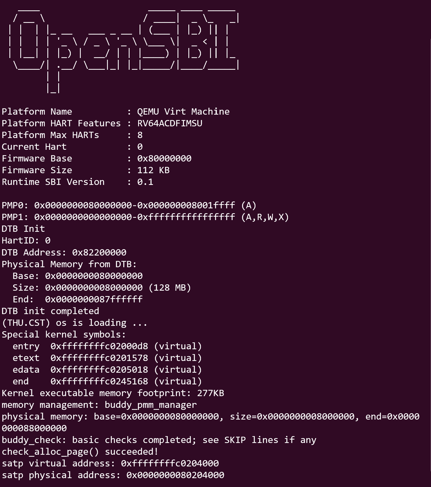

# C 部分：基于队友最新代码的整合说明（2026-10-26）

本次基于 main@42e5c8f（已合并 A 的更新）加入 Buddy。保留 A 的 entry.S、page_init，保留 First-Fit、Best-Fit 和老师测试。现有文件只修改 pmm.c 的 Buddy 头文件引用与管理器选择。

- 默认选 Best-Fit，对应现有 make grade 的检查。
- `DEFS=-DUSE_BUDDY` 选 Buddy。
- `DEFS=-DUSE_FIRST_FIT` 选 First-Fit。
- 两个选择宏不能同时定义。
- 本报告、prompt 和截图单独放在 lab2/report/C，不覆盖队友材料。

当前目录结构是仓库已有的 lab2/ 下直接放内核源文件；尚需在最终提交时整理为课程要求的 lab2 分支及 code/report 结构。

## 本次整合后的复测

2026-10-26：使用当前 main 的头文件，在 Windows 宿主环境编译运行 Buddy 测试，正常操作及 10 项非法操作测试通过；pmm.c 的三种分配器配置通过语法检查。这些检查不替代 Ubuntu make grade 与 RISC-V QEMU 启动验证。

在仓库 lab2 目录运行：

```bash
sh tests/run_host.sh
make grade
make clean
make qemu DEFS=-DUSE_BUDDY
```

退出 QEMU 后如需 First-Fit，先 make clean，再 make qemu DEFS=-DUSE_FIRST_FIT。

本次新基线的 Ubuntu 宿主测试、grade 与 QEMU 运行结果尚待补充。下方原报告、日志和截图记录的是 2026-10-21 的已验证版本；其中“最新”“本次”的表述指当时版本，不表示已验证本次合入后的内核。原测试提示词和历史操作记录保留真实原文，历史 code/ 路径在当前仓库中对应 lab2/。

---

## 原报告与历史验证记录（2026-10-21）

# 操作系统 Lab2 实验报告——C：Buddy System

## 实验基本信息

| 项目 | 内容 |
|---|---|
| 实验名称 | Lab2：物理内存和页表 |
| 本部分负责人 | C（提交前填写本人学号、姓名） |
| 本部分更新时间 | 2026-10-21 |
| 代码依据 | 小组仓库 main 分支，提交 02154da97e52d6bcd0ea31fc77af9df6385d85d6 的 lab2 目录 |
| 当前验证状态 | 宿主机测试已通过；用户已按编译运行步骤提供 QEMU 内核启动及 Buddy 基本自检通过截图（编译过程未单独截图） |

### 小组分工中 C 的部分

| 成员 | 负责的练习/模块 | 负责的报告内容 |
|---|---|---|
| C | Buddy System 的实现、接入和测试 | 设计、关键函数、实现提示词、测试提示词、实际迭代及验证结果 |

本文只包含 C 的工作。A、B 的代码实现和报告由对应成员提供，本文不代写其完成情况。

## 一、实验目的

1. 理解伙伴系统按照 2 的幂组织连续物理页的方式。
2. 实现块分裂、分配、回收和伙伴合并，并正确维护页面状态与空闲计数。
3. 将分配器接入已有的 pmm_manager 框架。
4. 分别设计实现提示词和测试提示词，结合实际测试检查 AI 生成的代码。

## 二、实验环境

| 项目 | 本部分实际使用情况 |
|---|---|
| AI 编程工具 | Codex 桌面应用 |
| 底层模型 | 当前会话未取得可核实的具体型号，提交前根据实际界面补充 |
| 本轮执行环境 | Windows 和 Ubuntu，使用原实验头文件进行宿主机验证；用户在 Ubuntu 中运行 QEMU |
| C 编译器 | 本机 Clang 3.4，gnu99；启用警告及 -Werror |
| 链接工具 | MSVC 14.43.34808 链接器 |
| Windows SDK | 10.0.22621.0 |
| RISC-V 环境 | 之前 Lab1 环境为 WSL Ubuntu 22.04、GCC 10.2.0、QEMU 4.1.1；工具直接访问 WSL 被拒绝，后由用户在 Ubuntu 终端执行并提供宿主机测试及 QEMU 启动截图 |

## 三、实验整体逻辑分析

### 3.1 C 模块的逻辑主线

```text
pmm_init()
  → init_pmm_manager() 选择管理器并初始化其状态
  → page_init() 建立页面描述符并注册空闲页面
  → buddy_init_memmap() 将范围组织为合法伙伴块
  → buddy_alloc_pages() / buddy_free_pages()
  → pmm_manager->check() 执行所选分配器的自检
```

页面探测和 page_init 由其他成员负责。Buddy 接收已确定可用的连续页描述符范围，不自行探测硬件。运行时每次选择一个管理器，不将同一批页面同时交给 Best-Fit 和 Buddy 管理。

### 3.2 本次接入方式

仓库最新代码已实现 page_init，并默认选择 Best-Fit。此次保持其函数体及 Best-Fit 代码原样，只在 pmm.c 的头文件引用和管理器选择处增加 USE_BUDDY 条件编译。

```c
#ifdef USE_BUDDY
    pmm_manager = &buddy_pmm_manager;
#else
    pmm_manager = &best_fit_pmm_manager;
#endif
```

默认构建仍运行 Best-Fit，使用 `DEFS=-DUSE_BUDDY` 才选择 Buddy。Makefile 已把 DEFS 加入编译参数，不需要改写其构建规则。

## 四、实验内容与实现

### 功能模块二·任务三：Buddy System 分配算法

**负责人：C。**

### 4.1 模块功能描述

新增 `kern/mm/buddy_pmm.c` 和 `kern/mm/buddy_pmm.h`，定义以下管理器接口：

```c
static void buddy_init(void);
static void buddy_init_memmap(struct Page *base, size_t n);
static struct Page *buddy_alloc_pages(size_t n);
static void buddy_free_pages(struct Page *base, size_t n);
static size_t buddy_nr_free_pages(void);
static void buddy_check(void);
const struct pmm_manager buddy_pmm_manager;
```

申请 n 页时将其向上取整为最小的 2 的幂；不足目标阶空闲块时从高阶取块并逐级分裂。释放时按保存的阶数找到伙伴，只有双方同阶、空闲且互为伙伴时才合并。

### 4.2 数据结构设计

使用 16 个空闲链表，对应 order 0～15，即 1～32768 页。最大块为 128 MiB，覆盖当前框架从 0x80000000 到 0x88000000 的物理页描述范围。可分配内存还要扣除固件、内核和描述符占用，不能将最大块大小当成实际可用空间。

不修改 `struct Page`，额外使用固定大小的 `metadata` 数组：

| 字段/状态 | 含义 |
|---|---|
| UNREGISTERED | 尚未交给 Buddy 的页面 |
| INTERIOR | 已注册的块内部页，或操作中的临时非首页状态 |
| FREE_HEAD | 空闲块首页 |
| ALLOC_HEAD | 已分配块首页 |
| order | 块首页对应的实际阶数 |
| requested | 分配时的原始申请页数 |

`Page.flags` 中 reserved 位在注册时清除，property 位只标记空闲块首页。`Page.property` 在块首页记录实际页数，内部页为 0；`page_link` 只用于链接空闲块首页。注册及释放时将 ref 清零。

必须同时检查 ALLOC_HEAD 和 requested，才能验证释放是否合法，不能只凭 PageProperty 为假判断已经分配。

### 4.3 分裂、合并与地址基准

伙伴按物理页号计算：

```text
i = 描述符数组索引
ppn = nbase + i
buddy_ppn = ppn XOR (1 << order)
buddy_index = buddy_ppn - nbase
```

计算后先检查边界，再检查伙伴状态和阶数。相邻但非伙伴的块不能合并。不同次注册的相邻范围可以合并，但前提是双方均已注册、同阶且确实互为伙伴；空洞和保留区域不会参与。

初始范围按物理页号对齐和剩余长度拆成多个合法块，因此不要求起点按整个范围大小对齐，也不要求总长度是 2 的幂。

例如申请 3 页时实际占用 4 页：

```text
alloc_pages(3) → 记录 requested=3、order=2 → 空闲页减少 4
free_pages(p,3) → 校验原请求 → 回收完整 4 页 → 尝试伙伴合并
```

### 4.4 每个函数的关键行为

| 函数 | 主要处理 |
|---|---|
| buddy_init | 初始化链表和独立元数据，不提前读取 pages |
| buddy_init_memmap | 先验证整个范围合法且未重复注册，再清除 reserved、初始化页面、按对齐分块并注册 |
| buddy_alloc_pages | 拒绝零和超上限请求；找块、分裂、记录首页状态、扣除实际页数 |
| buddy_free_pages | 检查描述符地址对齐、首页状态、原申请页数；逐级合并，空闲计数只增加一次 |
| buddy_nr_free_pages | 返回总空闲页数，不修改状态 |
| buddy_check | 基本申请回收和失败输入检查；无可用块时明确打印 SKIP |

非法释放采用 assert/panic 拒绝。申请失败返回 NULL，且不修改链表、元数据和空闲计数。最大页数在求阶前检查，避免无界移位。

### 4.5 不变量与开销

- 每个空闲块仅出现在一个对应阶链表中。
- 空闲块和已分配块覆盖互不重叠，不能包含未注册页面。
- 空闲计数等于各阶空闲块页数总和。
- 合并前移除伙伴的旧链表节点并清除旧首页状态。
- 全部分配结果被正确释放后，空闲页总数恢复。

元数据通常每页 8 字节，共 256 KiB，另有 16 个链表头和计数变量。新增静态数据位于 BSS；最新 page_init 使用链接后的 end 定位描述符数组，能够随内核大小变化调整位置，用户提供的 QEMU 截图已显示该版本完成初始化及 Buddy 基本自检。

分配复杂度为 O(log M)；释放还检查块内部页面，因此为 O(实际块页数 + log M)。固定元数据数组使实现无需 malloc，但增加了静态内存开销，且容量限定为当前平台。

### 4.6 最终实现提示词

以下保留用户实际提供并执行的实现提示词原文。

```text
[PROMPT]

请基于提供的 ucore Lab2 源码，实现 Buddy System物理内存分配器：

先阅读以下文件，确认实际接口和已有实现：
- kern/mm/pmm.h
- kern/mm/pmm.c
- kern/mm/memlayout.h
- kern/mm/mmu.h
- kern/mm/default_pmm.c
- libs/list.h
- Makefile

新增以下文件：
- kern/mm/buddy_pmm.c
- kern/mm/buddy_pmm.h

采用按阶数组织空闲链表的方式管理内存：
第 k 阶对应 2^k 个连续物理页。申请时向上取整到合适阶数，必要时需要分裂大块，释放时需要尝试逐级合并空闲伙伴。

优先复用现有 struct Page，不修改其布局。明确说明 flags、property、page_link 在 Buddy 实现中的含义，以及如何区分空闲块首页、已分配块首页和块内其他页面。


先说明设计方案和关键不变量，再给出完整代码、接入步骤和验证方法。

[RELY]

可以依赖源码中实际存在的以下接口，不得自行假设存在其他辅助函数。

1. 物理内存管理器接口

pmm.h 中的 struct pmm_manager：
- name
- init
- init_memmap
- alloc_pages
- free_pages
- nr_free_pages
- check

接口签名以实际 pmm.h 为准。

2. 页面描述结构

memlayout.h 中的 struct Page：
- ref：引用计数
- flags：页面状态
- property：可用于记录块大小或阶数，需说明具体约定
- page_link：链表节点

可以使用已有页面状态宏：
- SetPageReserved
- ClearPageReserved
- PageReserved
- SetPageProperty
- ClearPageProperty
- PageProperty

不能仅凭 PageProperty 为假，就判断该页是合法的已分配块首页。

3. 页面与地址相关定义

可以使用：
- PGSIZE、PGSHIFT
- pages、npage、nbase
- page2ppn()
- page2pa()
- set_page_ref()
- 源码中已有的地址转换和对齐宏

注意：
page - pages 是描述符数组索引；
page2ppn(page) 是物理页号；
page2pa(page) 是物理地址。

三者不能混用。计算伙伴时必须明确采用哪一种坐标，以及该坐标对应的块对齐规则。

4. 链表与调试支持

可以使用 libs/list.h 中实际提供的链表类型和操作，以及：
- le2page()
- assert()
- panic()
- cprintf()

可以参考 default_pmm.c 的管理器注册和接口组织方式，但不能照搬 First-Fit 的选块策略作为 Buddy 实现。

5. 运行前提

由 page_init() 建立页面描述符，并将合法空闲范围传给 init_memmap()。

Buddy 初始化和分配逻辑不得依赖 malloc，也不得依赖尚未建立的动态内存分配器。

不得修改源码中已有的测试来适配错误实现。


[GUARANTEE]

必须提供以下函数，内部函数可声明为 static：

1. static void buddy_init(void);

2. static void buddy_init_memmap(struct Page *base, size_t n);

3. static struct Page *buddy_alloc_pages(size_t n);

4. static void buddy_free_pages(struct Page *base, size_t n);

5. static size_t buddy_nr_free_pages(void);

6. static void buddy_check(void);

必须定义管理器：
const struct pmm_manager buddy_pmm_manager;

在 buddy_pmm.h 中提供对应的 extern 声明，并设置头文件保护。

还必须交付：
- pmm.c 中包含头文件、切换到 buddy_pmm_manager 的最小修改说明；
- 编译方式和运行方式；
- 如何从启动输出确认实际选中了 Buddy；
- 数据结构、阶数上限、空间开销和边界处理说明。


[SPECIFICATION]

一、整体状态约定

1. 第 k 阶空闲块恰好包含 2^k 页。
2. 每个空闲块只能在对应阶的链表中出现一次。
3. 空闲块之间不得重叠，已分配块不得出现在空闲链表中。
4. 所有块必须位于已注册的可用页面范围内。
5. nr_free_pages 统计可分配的物理页总数，而不是空闲块数量。
6. 为已分配块保存足够的元数据，能够校验首页、原始申请页数和实际分配阶数。
7. 申请和释放的接口约定为：

   p = alloc_pages(n);
   free_pages(p, n);

   其中释放时传入原始申请页数 n。

   例如申请 3 页，实际分配 4 页；
   free_pages(p, 3) 应回收完整的 4 页。

8. 申请 n 页失败时，不得改变空闲链表、块状态和空闲页计数。
9. 明确最大阶数及其依据，避免移位溢出和页数计算溢出。
10. 内部实现不得调用公共 alloc_pages()/free_pages() 包装器来执行同名功能，以免递归进入自身。


二、buddy_init()

输入：
无。

行为：
- 初始化各阶空闲链表。
- 清零空闲页总数。
- 初始化管理器自身的状态记录。
- 不自行探测物理内存，不调用 page_init()。
- 不读取尚未由 page_init() 建立的页面描述符。

完成后：
- 所有阶的链表为空。
- buddy_nr_free_pages() 返回 0。


三、buddy_init_memmap(struct Page *base, size_t n)

输入：
- base：待注册范围的首个 Page 描述符。
- n：该范围包含的连续页面数。

前置条件：
- 描述符范围合法；
- 对应页面可交给分配器使用；
- 与已经注册的范围不重叠。

行为：
- 检查范围和参数，不允许越界或重复登记。
- 初始化该范围内的引用计数、页面标记和块元数据。
- 按选定的伙伴坐标和对齐规则，将范围分解成合法的 2 的幂大小块。
- 将各块加入对应阶空闲链表。
- 不要求 base 按整个范围大小对齐，也不要求 n 是 2 的幂。
- 不得遗漏尾部页面，也不得为了凑整块包含范围外的页面。
- 支持多次注册互不重叠的范围，不得重置此前的管理状态。
- 跨注册范围是否允许合并必须明确约定；无论采用何种方案，都不得跨越未注册或保留页面。

完成后：
- 新增空闲页数恰好为 n。
- 新范围内的每一页均被准确管理一次。


四、buddy_alloc_pages(size_t n)

输入：
申请的连续物理页数。

行为：
- n 为 0 时返回 NULL，不修改状态。
- 将 n 向上取整到最小的 2 的幂，得到目标阶数。
- 检查计算溢出和最大阶数限制；超出能力时返回 NULL。
- 从目标阶开始向更高阶搜索可用块。
- 找不到足够大的连续块时返回 NULL。
- 找到更高阶块时，将其从链表移除，并逐级对半分裂。
- 每次分裂将不继续分配的一半加入相应空闲链表。
- 标记最终块为已分配，记录原始请求和实际阶数。
- 从空闲页总数中扣除实际块页数。

返回：
- 成功：分配块首页的 struct Page 指针。
- 失败：NULL。

示例：
申请 3 页时，返回至少 4 页的连续区域，空闲页数减少 4。
返回区域不得与其他尚未释放的分配结果重叠。


五、buddy_free_pages(struct Page *base, size_t n)

输入：
- base：之前分配返回的首页描述符。
- n：当时申请的原始页数。

行为：
- 修改状态前，校验地址、首页标记、分配状态和原始申请页数。
- 对 NULL、零页数、重复释放、非首页释放和不匹配页数，
  使用明确的断言或 panic 拒绝，不得静默破坏状态。
- 根据保存的元数据取得实际分配阶数。
- 将实际占用页数归还空闲页统计，只增加一次。
- 计算同阶伙伴的位置。
- 仅当伙伴属于合法已注册范围、确实空闲且阶数相同时才合并。
- 合并前从空闲链表移除伙伴。
- 合并后选低地址作为新块首页，阶数加一，并继续尝试。
- 达到最大阶数或伙伴不满足条件时停止。
- 将最终块加入对应阶链表，更新相关页面标记。

注意：
- 相邻块不一定是伙伴。
- 合并本身不额外增加空闲页数。
- 已分配块不能参与合并。
- 不得留下旧块首页仍被标记为独立空闲块的状态。


六、buddy_nr_free_pages()

输入：
无。

行为：
- 返回当前空闲物理页总数。
- 不修改任何链表或元数据。

结果必须与所有空闲块页数之和一致。


七、buddy_check()

至少完成以下基本自检：
- 保存测试开始时的空闲页总数。
- 申请并释放 1 页。
- 申请并释放一个 2 的幂大小块。
- 申请 3 页，验证实际扣除 4 页，并通过 free_pages(p, 3) 完整回收。
- 验证零页申请返回 NULL，且状态不变。
- 验证超过管理能力的申请失败，且状态不变。
- 释放测试中成功申请的全部块后，验证空闲页总数恢复。
- 使用 assert 检查结果，只有断言全部通过后才能打印通过信息。

测试不得修改其他分配器的测试，也不得用修改预期结果的方式掩盖实现错误。
若空闲容量不足以运行某项测试，应明确处理并说明，不能访问失败申请返回的 NULL 指针。
```

### 4.7 独立测试提示词

以下测试提示词在本轮“完成 C 部分”的任务中由 AI 整理并执行；不将其描述为用户此前逐字发送的消息。测试代码由上一轮已有工程检查补充、复用，全部在最新整合版上重新编译运行。

```text
[PROMPT]
针对当前 buddy_pmm.c 设计并执行独立测试。直接编译实际分配器源码，复用仓库的 Page、链表及管理器接口，不另写一个算法模型代替被测代码。保留内核 buddy_check 基本自检，增加可在宿主机运行的测试程序。
不得改动 First-Fit、Best-Fit 或老师的原有测试。实际执行后保存日志，区分宿主机验证和 QEMU 验证。

[RELY]
可以使用 code/kern/mm/buddy_pmm.c、原项目 pmm.h、memlayout.h、list.h 等头文件。宿主机提供测试用 pages、npage、nbase 及 cprintf、panic 实现；这些替身只提供执行环境，不代替分配逻辑。
允许通过包含 buddy_pmm.c 检查内部元数据和链表。使用固定随机种子保证结果可复现。

[GUARANTEE]
交付 tests/host_buddy.c、编译运行脚本和实际日志。覆盖最大块、分裂、合并、非伙伴不合并、不规则初始区间、空洞、耗尽和恢复、非 2 的幂请求、非法操作、随机操作。
保留源码，不修改测试预期以掩盖错误。不把未运行的 RISC-V/QEMU 检查写成通过。

[SPECIFICATION]
1. 创建合成页面描述符数组，先标记 reserved，再调用真实管理器注册。
2. 申请并释放最大 32768 页块；运行基本自检，验证申请 3 页实际占用 4 页且完整回收。
3. 注册起点不对齐、长度不是 2 的幂的区间，并注册有空洞的第二个区间；申请到耗尽后验证数量，全部释放后恢复。
4. 分两次逆序注册相邻的 8 页区间，验证可以申请合并后的 16 页块。
5. 在 4 页区间中先分配全部单页，只释放中间两页；虽然相邻但非伙伴，申请 2 页必须失败。释放其余页面后可重新申请 4 页块。
6. 进行 10000 次固定种子的随机分配/释放，每步独立遍历验证块对齐、覆盖不重叠、内部页状态、双向链表和空闲总页数，最后释放全部剩余块。
7. 分别测试 NULL、零页、页数不匹配、内部页、重复释放、重复注册、越界注册、未注册页、未对齐描述符和越界描述符。使用独立进程捕获预期 panic，并检查拒绝前后元数据、Page 字段、链表和统计状态哈希一致。
8. 空管理器的基本自检必须明确打印 SKIP，不能把未实际发生的申请测试写成通过。
9. 输出每项结果，正向测试全部通过才返回 0；预期非法操作返回约定退出码，未拒绝或异常改变状态则判失败。
```

### 4.8 实现迭代过程

| 阶段 | 发现的问题或需求 | 处理方法 | 实际结果 |
|---|---|---|---|
| 第一轮实现，10 月 19 日 | 原始框架没有 Buddy，且 page_init 待完成 | 按实现提示词新增六个接口和静态元数据，宿主机验证 | 分配器逻辑测试通过，未做 QEMU 验证 |
| 第二轮整合，10 月 21 日 | 仓库已有队友的初始化和 Best-Fit，不能整文件覆盖 | 从最新提交重新复制 Lab2，只加入 Buddy 和条件选择 | page_init、Best-Fit、老师测试保持原样 |
| 第二轮测试 | 需要对最新头文件和集成方式重新验证 | 重新执行严格语法检查、宿主机测试，状态快照补充 Page.ref | 两种管理器配置语法检查通过，宿主机测试通过 |
| 内核运行检查 | WSL 调用返回 E_ACCESSDENIED | 保存复现命令和预期检查项 | 未执行成功，未生成内核运行截图 |
| 用户终端验证 | 工具无法直接进入 WSL | 用户在 Ubuntu 中执行宿主机脚本及 Buddy 编译运行步骤 | 提供宿主机测试和 QEMU 基本自检通过截图 |

关键改进是把“直接切换默认管理器”改为编译时选择，避免影响队友的默认 Best-Fit 验证；分配算法本轮未因测试失败而改写，也没有改动测试预期。

## 五、测试与验证

### 5.1 已实际执行的验证

宿主机测试直接包含真实 buddy_pmm.c，使用仓库原始 Page 和链表实现。只替换执行环境所需的页面数组及打印/panic，不是另写一个 Buddy 模型自测。

| 项目 | 结果与覆盖依据 |
|---|---|
| Buddy 源码严格语法检查 | 通过，启用 -Wall、-Wextra、-Werror |
| pmm.c 默认/USE_BUDDY 两种配置 | 均通过 C 语法检查；不代表完整链接或 RISC-V 指令验证 |
| 最大块与基本自检 | 32768 页块可分配并回收；1、2、3 页申请均按约定计数 |
| 不对齐范围及空洞 | 注册 [1,14)、[20,27) 共 20 页，耗尽恰好 20 页，全部释放恢复 |
| 多次注册与伙伴合并 | 逆序注册相邻 8 页块，可分配合并后的 16 页块 |
| 相邻非伙伴 | 4 页区域只释放中间两页时，2 页申请失败；释放其余页后恢复 4 页块 |
| 随机操作 | 固定种子完成 10000 次操作，每步独立检查覆盖、对齐、内部状态、链表及空闲数 |
| 非法操作 | 10 类操作全部被拒绝，拒绝前后状态哈希一致 |
| 空管理器 | 自检明确打印 1/2/3 页申请 SKIP，没有把跳过视为执行成功 |

非法操作包括 NULL、零页、错误页数、内部页、重复释放、重复注册、越界注册、未注册页、未对齐描述符和越界描述符。负向测试以独立进程运行，预期 panic 返回 77；未拒绝或状态改变均判失败。

运行日志保存在 `host-test-results.txt`，包含以下真实输出：

```text
PASS: maximum block, recursive split/merge, basic checks
PASS: unaligned ranges, gaps, exhaustion and recovery
PASS: adjacent registrations coalesce
PASS: adjacent non-buddies do not merge
PASS: 10000 deterministic randomized operations
ALL HOST POSITIVE TESTS PASSED
ALL 10 INVALID-OPERATION TESTS PASSED; state hash unchanged before panic
```

### 5.2 测试为什么有效，以及局限

测试不只检查返回值，还独立统计所有空闲块，标记每一页的覆盖情况，能够发现重复分配、丢页、错误合并和计数错误。相邻非伙伴用例专门防止把一般相邻块误当成伙伴。随机操作检查不同申请和释放顺序下的状态一致性。

这些检查不能证明设备树探测、真实内存布局、地址映射和固件交互正确，也不构成对所有输入的形式证明。核验 state hash 是辅助检查，不能代替对断言位置和状态更新顺序的代码检查。

### 5.3 Ubuntu 内核验证步骤与结果

在本交付的 code 目录执行；切换编译参数前先 clean，避免复用另一种配置的目标文件。

```bash
make clean
make DEFS=-DUSE_BUDDY
make qemu DEFS=-DUSE_BUDDY
```

本次按以下项目核对用户提供的截图：

1. 输出 `memory management: buddy_pmm_manager`。
2. 内存初始化完成，Buddy 基本自检无 panic，充足内存时无 SKIP。
3. 输出 `check_alloc_page() succeeded!`。
4. 保存完整启动、自检截图到 report/images。

用户提供的 C-03 截图已显示 Buddy 管理器名称、基本自检完成和框架成功信息，期间没有 SKIP 或 panic。截图证明内核基本自检已运行，不代表完整宿主机随机及负向测试在 QEMU 内执行。

验证 Best-Fit 时退出 QEMU，执行：

```bash
make clean
make
make qemu
```

make grade 中的原评分测试针对初始化和 Best-Fit；Buddy 的独立测试应单独保留，不能把 grade 分数直接视为 Buddy 通过。

### 5.4 截图与验证范围

已保存宿主机测试日志、Ubuntu 宿主机截图及 QEMU 内核截图。C-01/C-02 对应全面算法测试，C-03 对应内核接入和基本自检。QEMU 截图不包含编译命令输出，因此不作为完整编译日志。

### 5.5 小组测试汇总表（C 部分）

| 测试项目 | 负责人 | 预期结果 | 实际结果 | 截图编号 |
|---|---|---|---|---|
| Buddy 分裂与合并 | C | 大块能够逐级分裂以满足申请；同阶空闲伙伴能够逐级合并；相邻非伙伴不合并；全部释放后空闲页数恢复 | 宿主机测试已通过最大块分配、分裂合并、相邻注册区域合并和非伙伴不合并检查；QEMU 中的 Buddy 基本自检也已通过（见 C-03） | C-01（宿主机测试截图） |
| Buddy 边界与内存不足情况 | C | 非整齐范围不丢页、不越界；内存耗尽时返回 NULL 且状态不变；申请 3 页按 4 页回收；非法操作被拒绝；全部释放后计数恢复 | 宿主机测试已通过不规则范围、空洞、耗尽恢复、基本自检、10000 次随机操作及 10 类非法操作检查；QEMU 中的 Buddy 基本自检也已通过（见 C-03） | C-02（与 C-01 共用宿主机截图） |

C-01、C-02 共用实际 Ubuntu 宿主机测试截图；QEMU 启动及内核基本自检另存 C-03，二者验证范围不同。

### 补充：Ubuntu 宿主机测试截图

用户在 Ubuntu 中执行 `sh tests/run_host.sh`，截图显示正向检查通过、10 类非法操作被拒绝，末行显示 `ALL HOST TESTS PASSED`。这确认 Linux 宿主机测试脚本已实际执行；随后用户提供了单独的 QEMU 内核截图，见 C-03。

三条 `SKIP request` 来自测试程序最后专门构造的空管理器场景，不是前面充足内存场景的测试失败。



C-01 和 C-02 共用这张实际截图，分别对应分裂合并检查和边界/非法操作检查。截图底部略有裁切，最终提交时可补一张包含完整末行和终端提示符的截图。

### C-03：QEMU 中的 Buddy 管理器及基本自检



截图实际输出包括：

```text
memory management: buddy_pmm_manager
buddy_check: basic checks completed; see SKIP lines if any
check_alloc_page() succeeded!
```

该次内核自检没有出现 SKIP。末尾的 `see SKIP lines if any` 是固定提示，不代表发生了跳过。按照本版 buddy_check 代码，1、2、3 页申请及释放和零/超上限申请检查执行完毕，断言未失败。

设备树探测的物理内存起始地址为 0x80000000，大小 128 MiB；初始化输出的末地址为排他上界 0x88000000。设备树打印的 0x87ffffff 是最后一个有效字节，两种写法不矛盾。

截图显示内核 end 为 0xffffffffc0245168，内核占用约 277 KiB；页表虚拟地址为 0xffffffffc0204000，对应物理地址 0x80204000。这些是本次构建的实际值，后续改变源码可能变化。

## 六、实验总结与收获

### 6.1 对操作系统的理解

| 实验知识点 | 对应 OS 原理及理解 |
|---|---|
| 按阶分块 | 通过限制块大小简化管理，但 3 页申请占 4 页会产生内部碎片 |
| 伙伴合并 | 合并依赖共同上级块和对齐关系，相邻并不充分 |
| 页面元数据 | 地址、页号、描述符是不同概念；状态必须和链表同步维护 |
| 分配失败 | 总空闲页足够也不代表存在足够大的连续块 |

本模块未实现进程地址空间、页面置换、交换区、并发分配同步和任意大小对象分配。Buddy 是页级分配器，不能替代这些功能。

### 6.2 AI 协作开发的经验

实现提示词明确接口、约束和非法输入行为后，生成代码才容易与已有框架接入。测试提示词要明确可观察结果和不变量，不能只要求“写一些测试”。验证结果必须区分宿主机逻辑检查与真实内核运行，不能因前者通过就声称实验全部完成。

### 6.3 C 的交付状态

- [x] Buddy 模块和管理器注册。
- [x] 保留队友代码的可切换集成。
- [x] 实现提示词、测试提示词和本轮过程记录。
- [x] 最新整合版宿主机验证及真实日志。
- [x] 用户执行编译运行步骤并提供 QEMU 内核基本自检截图；编译日志未单独保存。
- [ ] 提交前填写本人身份信息，将本部分合入小组报告。
