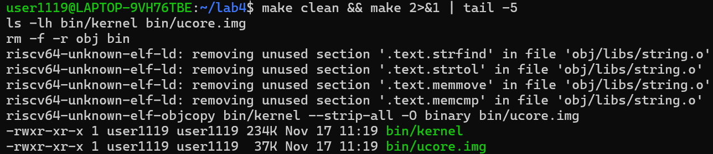
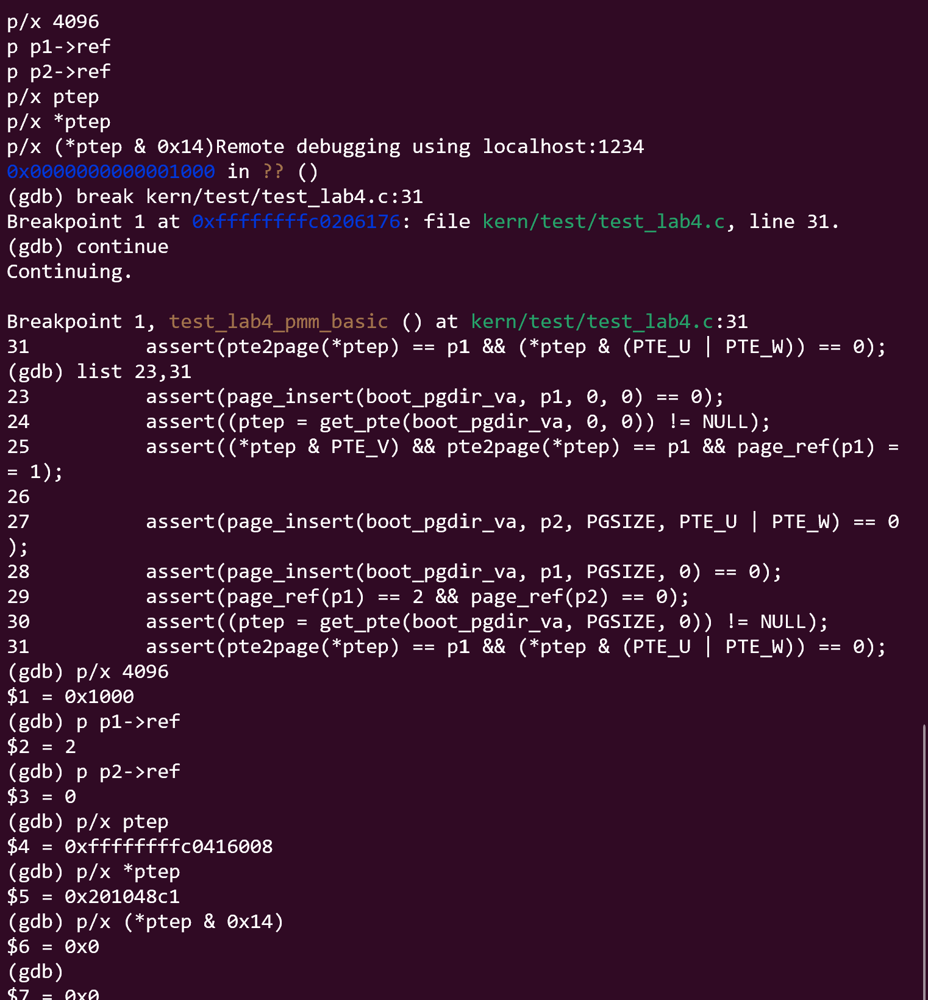
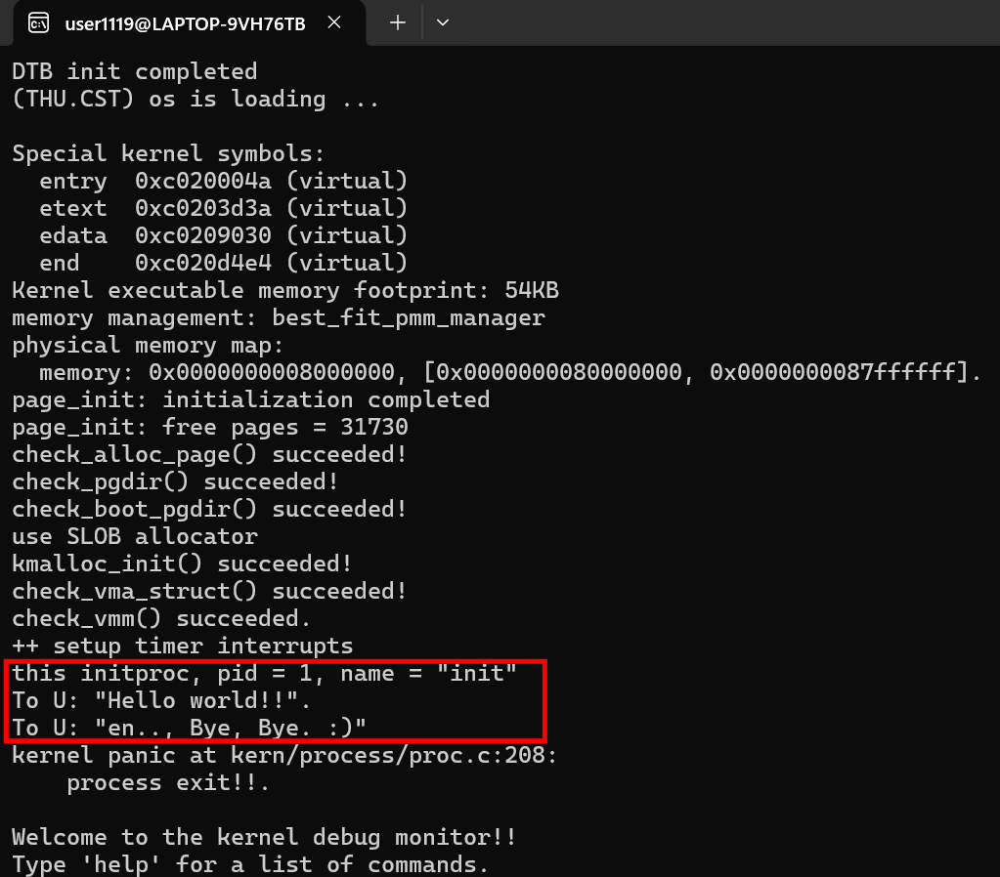
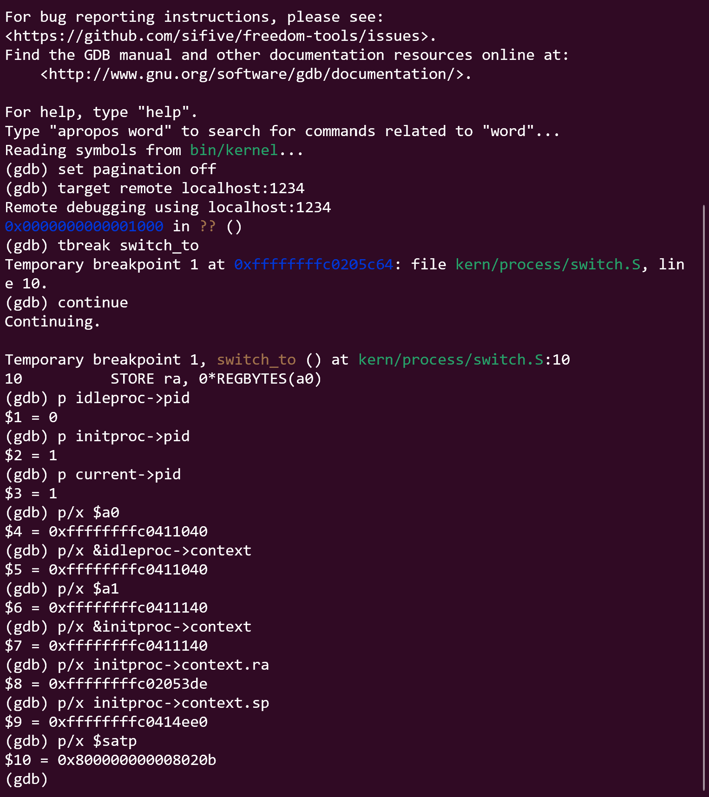
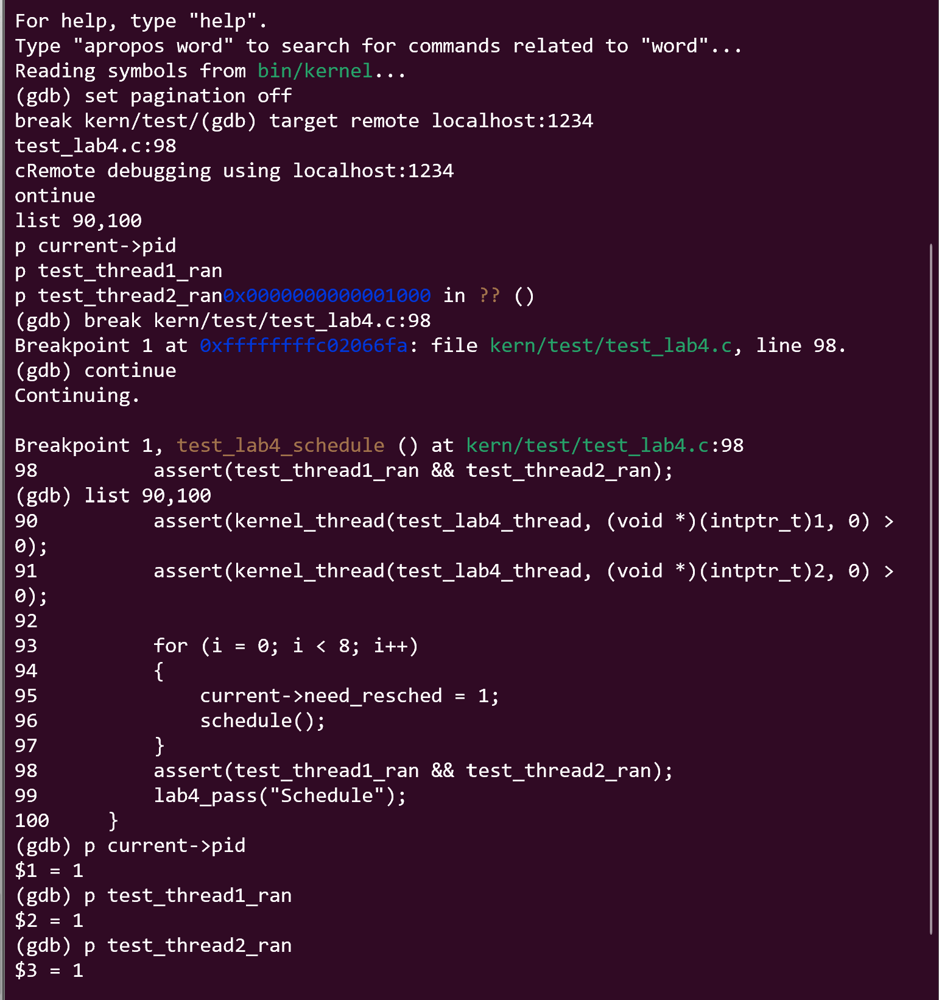
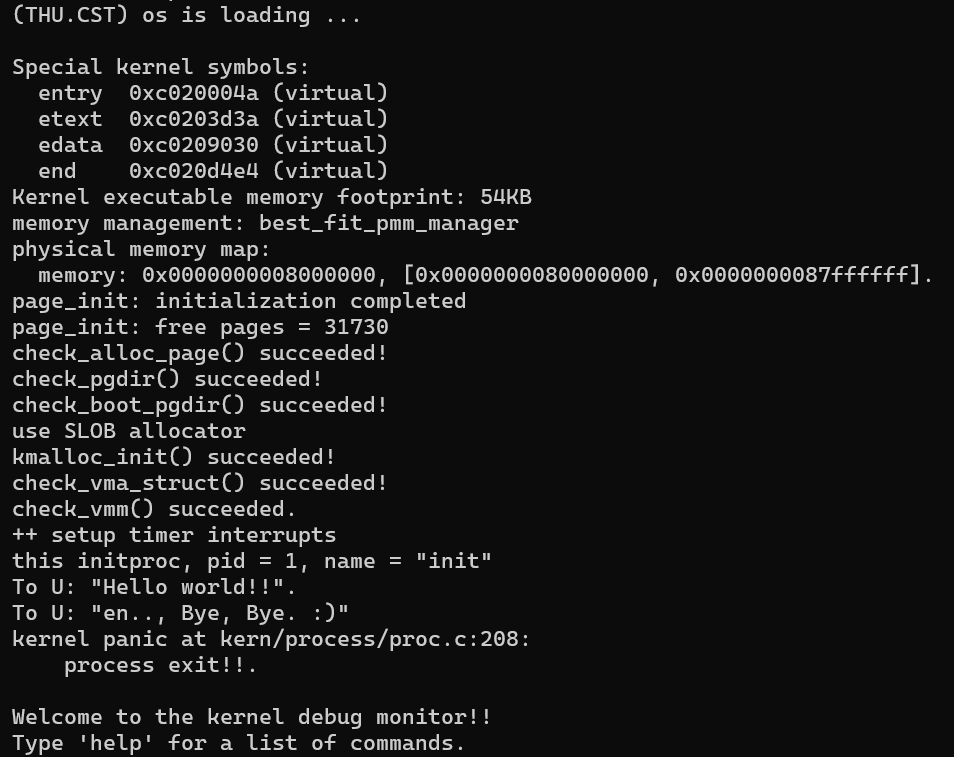
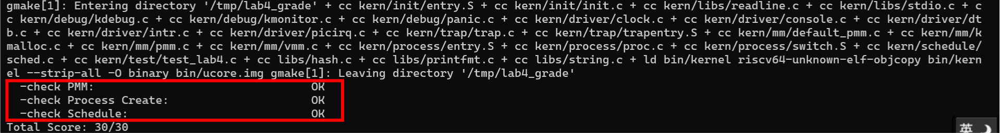

# 操作系统lab4实验报告

# 实验基本信息

|项目|内容|
|---|---|
|实验名称|Lab4 进程管理|
|小组成员|A：2413685\-刘晟槿<br>B：2413978\-缪承佑<br>C：2412000\-文玥|
|小组仓库|[Esther\-ww/nankai\-os\-labs\-2026](https://github.com/Esther-ww/nankai-os-labs-2026)|
|完成日期||


### 小组分工

|成员|代码范围|报告与验证|
|---|---|---|
|A：2413685\-刘晟槿|模块一，页映射建立与撤销；衔接 Lab2 物理页分配器和 `page_init`|4\.1 内存衔接、4\.2、第五章 PMM 证据和第六章内存部分。Challenge 2 如需提交由 A 整理|
|B：2413978\-缪承佑|模块二，创建 idle 和 init、登记内核线程；衔接 Lab3 的 `trap.c` 处理函数|4\.1 中断分发衔接、4\.3、第五章 Process Create 证据和第六章创建部分|
|C：2412000\-文玥|模块三，就绪线程选择、页表和寄存器现场切换；衔接 Lab3 的 `trapentry.S` 返回路径|4\.1 汇编衔接、4\.4、第五章 Schedule 证据和第六章调度部分。汇总第三章和整核验证。Challenge 1 如需提交由 C 整理|


## 一、实验目的

1. 理解虚拟地址、页表项、物理页和引用计数的关系，能解释建立、替换和撤销映射时哪些状态必须一起更新。

2. 从启动现场构造空闲线程，再为新的内核线程分配控制块和内核栈，准备首次执行所需的寄存器现场。

3. 从可运行线程中选择下一位，跟踪 CPU 从 idle 切到 init 的过程，并通过教师创建的额外线程验证调度器能持续轮转。


## 二、实验环境

### 2\.1 开发与运行环境

|项目|已知信息|本次复现时补录|
|---|---|---|
|宿主与终端|Windows PowerShell 用于资料核对；小组常用 Ubuntu\-22\.04（WSL2），Ubuntu 用户为 `oslab`|运行终端的实际目录、发行版版本|
|工具链|交接记录为 SiFive `riscv64-unknown-elf-gcc` 10\.2\.0、GDB 10\.1、QEMU 4\.1\.1|分别记录本次三个可执行文件的路径和版本|
|目标|Makefile 使用 `qemu-system-riscv64`、`virt` 机器和默认固件，将 `bin/ucore.img` 加载到物理地址 `0x80200000`|记录被测提交或整合包标识。普通运行和评分使用同一版实现|
|原始包指纹|SHA\-256 为 `7A92F243F88CA9A4EC78B52E554A14D78A41BBF6A79A1275F6CC929AAEBCEBA2`|实现后的版本另行标识|


### 2\.2 使用的 AI 工具

|成员|AI 编程工具|底层模型|
|---|---|---|
|A：2413685\-刘晟槿|codex|GPT 6\.1|
|B：2413978\-缪承佑|DeepSeek Harness|DeepSeek\-V4\-Flash|
|C：241200\-文玥|codex|GPT6 Astra|


## 三、实验整体逻辑分析

### 3\.1 本章节的逻辑主线

内核要让一个新线程运行，先要有可用内存放它的控制块和内核栈，再要记录“这个线程从哪里开始、用哪一个栈”，最后才由调度器把 CPU 交给它。前两个阶段可以在 `current` 仍指向 idle 时完成。判断 init 真正运行的证据，是 CPU 恢复了它的现场并执行到 `init_main`。


### 3\.2 功能的逐步实现

|顺序|调用路径|完成的工作|
|---|---|---|
|① 准备内存|`kern_init → pmm_init`|初始化物理页管理器，调用 `check_alloc_page`、`check_pgdir`、`check_boot_pgdir`，再初始化 `kmalloc`|
|② 准备运行环境|`pic_init → idt_init → vmm_init`|设置中断入口并检查虚拟内存区域。现有 `find_vma` 以左闭右开的范围判断地址归属|
|③ 创建线程|`proc_init → kernel_thread → do_fork`|让 idle 复用启动现场；为 init 分配 PCB 和内核栈，登记 PID、父线程和首次运行现场|
|④ 选出线程|`clock_init → intr_enable → cpu_idle → schedule`|idle 发现需要重新调度，从进程链表挑选就绪线程|
|⑤ 切到线程|`proc_run → switch_to`|更新当前线程，装入目标页表，保存旧线程的寄存器并恢复新线程的寄存器|
|⑥ 首次执行|`forkret → forkrets → __trapret → kernel_thread_entry → init_main`|从预置 trapframe 恢复现场，经 `sret` 到达入口，把参数送入 `a0`，调用线程函数|


## 四、实验内容与实现

### 4\.1 前置实验代码衔接

|负责人|本次源码位置|衔接要求与检查方法|
|---|---|---|
|A：2413685\-刘晟槿<br>|`kern/mm/default_pmm.c`、`kern/mm/pmm.c`|补齐物理页管理器和 `page_init`。原包包含对缺失头文件 `best_fit_pmm.h` 的引用，`pmm.c` 实际选择 `default_pmm_manager`。对齐导出符号，保留教师的 `basic_check`、`best_fit_check`；后者会部分释放一个连续块，再检查最佳适配结果|
|B：2413978\-缪承佑<br>|`kern/trap/trap.c`|现有 `trap` 已按 `cause` 分派给 `interrupt_handler` 和 `exception_handler`。从整合版按函数接入，核对原有时钟续约、计数及 Lab3 结束测试的关机逻辑与 Lab4 运行流程的关系|
|C：2412000\-文玥<br>|`kern/trap/trapentry.S`|补齐 `RESTORE_ALL` 和 `__alltraps` 调用 `trap` 的两处空位。保留 Lab4 的 `forkrets`：它将传入的 trapframe 指针写入 `sp`，随后跳到 `__trapret`|

B 与 C 共用 `kern/process/proc.c`。B 合入 `function2`，C 合入 `function3`。各人保留 Lab4 标记，提交时把自己所负责标记中的 `YOUR CODE` 替换为本人学号。


### 4\.2 功能模块一：虚拟内存页操作

#### 4\.2\.1 模块功能描述

**负责人　A：刘晟槿 2413685**

本模块主要实现虚拟地址与物理页之间的映射管理，包括建立页映射和删除页映射两个核心操作：

```Plain Text
int page_insert(pde_t *pgdir, struct Page *page, uintptr_t la, uint32_t perm);
void page_remove(pde_t *pgdir, uintptr_t la);
```

其中，`pgdir` 表示页表根的内核虚拟地址，`page` 表示待映射的物理页描述符，`la` 表示目标线性地址，`perm` 表示页表项的访问权限。

`page_insert()` 用于建立或更新虚拟页与物理页之间的映射关系；`page_remove()` 用于撤销指定线性地址对应的页映射。两个函数需要共同维护页表项、物理页引用计数以及 TLB 地址转换缓存的一致性。

#### 4\.2\.2 实现说明与代码位置

本模块在 `kern/mm/pmm.c` 中完成，主要实现了以下功能。

**（1）page\_insert\(\)：建立或更新页映射**

首先调用：

```Plain Text
get_pte(pgdir, la, 1);
```

获取目标线性地址对应的叶级页表项。参数 `1` 表示允许创建缺失的中间页表。

如果无法获得有效页表项，则返回 `-E_NO_MEM`。

成功获取页表项后，首先检查原页表项是否有效。如果已经存在映射，则保存原来对应的物理页。

随后增加新物理页的引用计数，并通过：

```Plain Text
pte_create(page2ppn(page), perm);
```

生成新的页表项，写入目标 PTE。

完成页表更新后，调用 `tlb_invalidate()` 刷新对应线性地址的 TLB 缓存，最后减少旧物理页的引用计数。如果旧页引用计数降为零，则调用 `free_page()` 释放物理页。

特别地，对于同一个物理页重新映射到同一个虚拟地址的情况，采用先增加新引用、再减少旧引用的方式，避免引用计数暂时降为零而导致物理页被错误释放。

**（2）page\_remove\(\)：删除页映射**

首先调用：

```Plain Text
get_pte(pgdir, la, 0);
```

查询目标线性地址对应的页表项。参数 `0` 表示只查询现有页表，不创建新的中间页表。

如果页表项不存在，或者 `PTE_V` 标志未设置，则直接返回。

如果映射有效，则通过 `pte2page()` 获取对应的物理页描述符，随后依次执行：

1. 将目标页表项清零，撤销虚拟地址映射。

2. 调用 `tlb_invalidate()`，使对应地址的旧 TLB 转换失效。

3. 减少物理页引用计数。

4. 当引用计数降为零时，调用 `free_page()` 释放物理页。

这种处理方式能够避免重复删除同一映射时出现重复释放的问题。

**（3）tlb\_invalidate\(\)：刷新地址转换缓存**

本实验采用 RISC\-V 的 `sfence.vma` 指令刷新指定线性地址的地址转换缓存，最终实现如下：

```Plain Text
void tlb_invalidate(pde_t *pgdir, uintptr_t la)
{
    asm volatile("sfence.vma %0" : : "r"(la) : "memory");
}
```

其中，`sfence.vma` 用于使指定虚拟地址对应的地址转换缓存失效，`"memory"` 是编译器内存屏障约束，防止编译器将相关内存访问重排到汇编指令之外。

#### 4\.2\.3 实现迭代过程

本模块的实现主要围绕页表查询、映射更新、引用计数维护和地址转换缓存同步展开。

**第一阶段：核对页表操作接口。**

首先阅读 `kern/mm/pmm.c`、`pmm.h`、`mmu.h` 和 `memlayout.h`，明确页表项结构、物理页描述符以及地址转换关系。

重点核对 `page2ppn()` 与 `pte_create()` 的参数单位，确保传入的是物理页号，而不是物理地址。

同时确认 `get_pte()` 的第三个参数含义：建立映射时使用 `1`，删除映射时使用 `0`。

**第二阶段：实现映射建立与更新。**

实现 `page_insert()`，重点处理以下情况：

- 新建映射时增加物理页引用计数。

- 已有映射且新旧物理页不同，正确减少旧页引用。

- 同一物理页重新映射到同一虚拟地址时，保证引用计数不发生错误变化。

- 更新页表权限时重新生成完整 PTE，避免旧权限残留。

- 页表项更新后刷新对应 TLB。

**第三阶段：实现映射删除。**

实现 `page_remove()`，使用不创建中间页表的查询方式，避免删除操作额外分配内存。

通过先清除 PTE、再刷新 TLB、最后减少引用计数的顺序，保证页表状态和物理页生命周期的一致性。

**第四阶段：处理异常情况。**

进一步考虑以下边界情况：

- 删除不存在的映射。

- 对同一个虚拟地址重复删除。

- 多个虚拟地址映射同一个物理页。

- 同一物理页重新映射并修改访问权限。

- 创建中间页表时发生内存分配失败。

其中，`get_pte()` 在创建多级页表时可能已经成功分配并安装上级中间页表，但在后续层级分配失败。因此，返回 `NULL` 时不能简单认为所有页表状态都完全恢复到了调用前。此时目标叶级映射尚未写入，目标物理页引用计数保持不变，但本次创建的部分中间页表可能仍然存在。

#### 4\.2\.4 实验验证与结果

本模块首先进行了目标文件强制重新编译，执行命令如下：

```Plain Text
cd /mnt/d/OSlab/lab4

make -B obj/kern/mm/pmm.o obj/kern/mm/default_pmm.o
```

实际终端输出：

```Plain Text
+ cc kern/mm/pmm.c
+ cc kern/mm/default_pmm.c
```

两个目标文件均完成编译，未出现编译错误，说明本模块的相关代码能够通过当前编译环境的编译检查。

综上，本模块已经完成核心代码实现及目标文件编译检查。当前编译结果证明代码通过了相应的编译阶段，但完整的 QEMU 运行测试及教师功能测试仍需进一步验证，不能仅凭编译成功认定所有运行时功能均已通过。

#### 4\.2\.5 最终提示词

```Plain Text
[PROMPT]
基于 Lab4 源码实现虚拟内存页映射管理模块。
首先阅读 kern/mm/pmm.c、pmm.h、mmu.h、
memlayout.h 及 tools/test_lab4.c，理解现有页表
结构和物理页管理接口。
在 kern/mm/pmm.c 的 function1 位置实现
page_insert() 和 page_remove()。

[RELY]
使用 get_pte(pgdir, la, create)、
page2ppn()、pte_create()、pte2page()、
page_ref_inc/dec()、free_page() 和
tlb_invalidate() 等已有接口。
注意区分物理地址与物理页号。

[GUARANTEE]
保持原有函数签名，不修改教师自检代码。
正确处理新建映射、异页替换、同页重新映射、
重复删除和内存分配失败等情况。
明确说明异常情况下页表项、引用计数和
中间页表的状态。

[SPECIFICATION]
1. 新映射成功后增加物理页引用计数。
2. 替换映射时正确更新新旧物理页引用。
3. 同一物理页重新映射时不能错误释放物理页。
4. 更新页表权限时清除旧权限残留。
5. 删除无效映射时安全返回。
6. 最后一个引用消失时释放物理页。
7. 页表更新后刷新对应地址的 TLB。
8. 无法获得叶级页表项时返回 -E_NO_MEM。
9. 分别说明各类边界情况的实现逻辑和验证结果。
```

#### 4\.2\.6 本模块总结

通过本模块的实现，完成了虚拟地址到物理页的映射建立、更新和撤销操作，理解了多级页表查询机制、物理页引用计数管理以及 TLB 一致性维护的基本原理。

实验过程中重点处理了同一物理页重复映射、不同物理页替换以及重复删除等边界情况，加深了对虚拟内存管理和物理页生命周期的理解。


### 4\.3 功能模块二　进程创建与初始化


**负责人　B****：2413978\-缪承佑**

#### 模块功能描述

```C
// alloc_proc - alloc a proc_struct and init all fields of proc_struct
static struct proc_struct *
alloc_proc(void)
{
    struct proc_struct *proc = (struct proc_struct *)kmalloc(sizeof(struct proc_struct));
    if (proc != NULL)
    {
        // A blank PCB: unknown state, unassigned pid, no stack/context/trapframe.
        proc->state = PROC_UNINIT;
        proc->pid = -1;
        proc->runs = 0;
        proc->kstack = 0;
        proc->need_resched = 0;
        proc->parent = NULL;
        proc->mm = NULL;
        memset(&(proc->context), 0, sizeof(struct context));
        proc->tf = NULL;
        // Kernel threads share the kernel address space described by the boot page table.
        proc->pgdir = boot_pgdir_pa;
        proc->flags = 0;
        memset(proc->name, 0, sizeof(proc->name));
    }
    return proc;
}

// proc_init - set up the first kernel thread idleproc "idle" by itself and
//           - create the second kernel thread init_main
void proc_init(void)
{
    int i;

    list_init(&proc_list);
    for (i = 0; i < HASH_LIST_SIZE; i++)
    {
        list_init(hash_list + i);
    }

    if ((idleproc = alloc_proc()) == NULL)
    {
        panic("cannot alloc idleproc.\n");
    }

    // idleproc reuses the boot stack and the boot context, so it has no
    // dedicated kernel stack and no trapframe of its own.
    idleproc->pid = 0;
    idleproc->state = PROC_RUNNABLE;
    idleproc->kstack = (uintptr_t)bootstack;
    idleproc->need_resched = 1;
    current = idleproc;

    int pid = kernel_thread(init_main, "Hello world!!", 0);
    if (pid <= 0)
    {
        panic("create init_main failed.\n");
    }

    initproc = find_proc(pid);
    set_proc_name(initproc, "init");

    assert(idleproc != NULL && idleproc->pid == 0);
    assert(initproc != NULL && initproc->pid == 1);
}

// kernel_thread - create a kernel thread using "fn" function
// NOTE: the contents of temp trapframe tf will be copied to
//       proc->tf in do_fork-->copy_thread function
int kernel_thread(int (*fn)(void *), void *arg, uint32_t clone_flags)
{
    struct trapframe tf;
    memset(&tf, 0, sizeof(struct trapframe));

    // kernel_thread_entry moves s1 into a0 and then jumps to s0.
    tf.gpr.s0 = (uintptr_t)fn;
    tf.gpr.s1 = (uintptr_t)arg;
    // Return to S-mode with interrupts enabled after sret.
    tf.status = (read_csr(sstatus) | SSTATUS_SPP | SSTATUS_SPIE) & ~SSTATUS_SIE;
    tf.epc = (uintptr_t)kernel_thread_entry;

    return do_fork(clone_flags | CLONE_VM, 0, &tf);
}

// do_fork - parent process for a new child process
//    1. call alloc_proc to allocate a proc_struct
//    2. call setup_kstack to allocate a kernel stack for child process
//    3. call copy_mm to dup OR share mm according clone_flag
//    4. call copy_thread to setup tf & context in proc_struct
//    5. insert proc_struct into hash_list && proc_list
//    6. call wakeup_proc to make the new child process RUNNABLE
//    7. set ret vaule using child proc->pid
int do_fork(uint32_t clone_flags, uintptr_t stack, struct trapframe *tf)
{
    int ret = -E_NO_FREE_PROC;
    struct proc_struct *proc;
    bool intr_flag;

    if (nr_process >= MAX_PROCESS)
    {
        goto fork_out;
    }
    ret = -E_NO_MEM;

    if ((proc = alloc_proc()) == NULL)
    {
        goto fork_out;
    }
    proc->parent = current;

    if (setup_kstack(proc) != 0)
    {
        goto bad_fork_cleanup_proc;
    }
    if (copy_mm(clone_flags, proc) != 0)
    {
        goto bad_fork_cleanup_kstack;
    }
    copy_thread(proc, stack, tf);

    // Publish the new child only after all of its resources are ready.
    local_intr_save(intr_flag);
    {
        proc->pid = get_pid();
        hash_proc(proc);
        nr_process++;
        list_add(&proc_list, &(proc->list_link));
    }
    local_intr_restore(intr_flag);

    wakeup_proc(proc);

    ret = proc->pid;
fork_out:
    return ret;

bad_fork_cleanup_kstack:
    put_kstack(proc);
bad_fork_cleanup_proc:
    kfree(proc);
    goto fork_out;
}

// copy_thread - setup the trapframe on the child's kernel stack and the
//               initial switch context, so the child starts at kernel_thread_entry
static void
copy_thread(struct proc_struct *proc, uintptr_t esp, struct trapframe *tf)
{
    // The trapframe sits at the top of the child's own kernel stack.
    proc->tf = (struct trapframe *)(proc->kstack + KSTACKSIZE) - 1;
    *(proc->tf) = *tf;

    // The child returns 0 from do_fork; a kernel thread keeps running on its kernel stack.
    proc->tf->gpr.a0 = 0;
    proc->tf->gpr.sp = (esp == 0) ? (uintptr_t)proc->tf : esp;

    // The first schedule of this child enters forkret -> forkrets -> __trapret.
    proc->context.ra = (uintptr_t)forkret;
    proc->context.sp = (uintptr_t)(proc->tf);
}

// copy_mm - process "mm" copy, currently only kernel threads exist, which
//           borrow the kernel address space of current
static int
copy_mm(uint32_t clone_flags, struct proc_struct *proc)
{
    assert(current->mm == NULL);
    proc->mm = NULL;
    return 0;
}
```


#### 相关函数

|函数|输入与输出|应达到的状态|
|---|---|---|
|`alloc_proc`|无参数，返回 PCB 指针，分配失败返回 NULL|新 PCB 处于 `PROC_UNINIT`，PID 为 \-1，现场和计数有确定初值，内核线程使用启动页表|
|`proc_init`|无参数和返回值|初始化链表与哈希桶；idle 的 PID 为 0，复用 `bootstack`，成为 `current`；创建 PID 为 1、名为 init 的首个子线程|
|`kernel_thread`|线程函数、实参、标志 → 子 PID 或负错误码|构造初始 trapframe，将入口和参数保存在 `s0/s1`，设置内核返回状态，把任务交给 `do_fork`|
|`do_fork`|标志、栈指针、有效 trapframe → 子 PID 或负错误码|分配 PCB 和内核栈，准备现场，登记 PID、父线程、链表和哈希，最后唤醒；分配失败时清理此前取得的资源|
|`copy_thread`|子 PCB、初始栈指针、待复制的 trapframe；无返回值|trapframe 位于新内核栈，子返回值 `a0` 为 0；`context.ra` 指向 `forkret`，`context.sp` 指向初始帧|
|`copy_mm`|标志、子 PCB → 当前内核线程路径成功返回 0|本次前提是 `current->mm == NULL`，子线程共享内核地址空间|


#### 最终提示词

```Plain Text
[PROMPT]
阅读 kern/process/proc.c、proc.h、entry.S、kern/trap/trap.h、trapentry.S、kern/schedule/sched.c 和 tools/test_lab4.c。在 proc.c 的 function2 位置实现本节六个函数，解释从启动现场到 init 首次可运行的顺序。
[RELY]
复用 get_pid、hash_proc、find_proc、setup_kstack、put_kstack、forkret、wakeup_proc。按 proc_struct、context 和 trapframe 的实际字段组织数据。KSTACKPAGE 为 2，boot_pgdir_pa 是页表根物理地址。与 C 约定 idle 的首次调度标志、就绪状态及 context.ra/sp。
[GUARANTEE]
保持六个函数签名和 init_main 的教师输出，成功创建返回 PID。登记后的 PCB 可按 PID 查到；失败后进程数、登记结构和已分配资源保持一致。给出创建、失败回滚和父子关系测试。
[SPECIFICATION]
初始化后的 current 指向 idle。idle 使用 bootstack，PID 为 0，父指针为空。init 的父线程为 idle，PID 为 1。为普通内核线程建立自己的内核栈；以 s0/s1 传入口及实参、epc 指向 kernel_thread_entry。do_fork 达到进程数上限时返回 -E_NO_FREE_PROC，内存不足时返回 -E_NO_MEM。先准备资源和上下文，再登记和唤醒。只在合适的临界区发布共享状态。
```


#### 实现说明与代码位置

`kern/process/proc.c` 已提供进程表、哈希表和栈辅助函数。`get_pid` 在达到上界时绕回 1，必要时扫描现有进程并跳过占用的 PID。`next_safe` 记录后方需要再次检查的界限。这个办法保证在用 PID 的唯一性，退出并回收 PID 后，旧号码仍可再次分配。


#### 函数关键处理

|函数|关键处理|
|---|---|
|`alloc_proc`|`kmalloc` 一块 PCB，逐字段写入空白初值|
|`proc_init`|初始化进程链表与哈希桶，登记 idle，再经 `kernel_thread` 创建 init|
|`kernel_thread`|在栈上构造初始 trapframe，交给 `do_fork`|
|`do_fork`|备齐 PCB、内核栈和首次现场后才登记并唤醒，失败按已取得资源回退|
|`copy_thread`|把 trapframe 放到子内核栈顶，设置第一次切换使用的 `context`|
|`copy_mm`|内核线程路径只断言 `current->mm==NULL` 并把子 `mm` 置空|


#### 实现迭代过程


实现按“先读接口约定、再落代码、最后找可执行的验证手段”三步推进；下面记录设计时特意避开的三处易错点，以及验证阶段一次真实的失败与修正。


1\. **登记时机。**

如果按“`alloc_proc` 之后立刻 `get_pid`/`hash_proc`/`list_add`，再 `setup_kstack`”的顺序写，内核栈或 `copy_mm` 失败时 PCB 已经出现在哈希表和进程链表里，回退就必须把两处链接摘掉并回退 `nr_process`，很容易出现“进程数对不上”的中间状态。实现里把登记整体放到资源就绪之后，失败路径只剩 `put_kstack` 与 `kfree` 两步。


2\. **首次运行的现场放置。**

trapframe 直接放在子内核栈顶：`(struct trapframe *)(proc->kstack + KSTACKSIZE) - 1`，没有另找一块内存，也没有按字节手工减 `sizeof(struct trapframe)`，而是让编译器按结构体大小参与指针运算。trapframe 由 32 个通用寄存器加 `status`、`epc`、`badvaddr`、`cause` 组成，共 288 字节，是 16 的倍数，而栈顶本身是页对齐的，所以 `tf` 与 `tf->gpr.sp` 都满足 ABI 的栈对齐要求。`context.ra` 写成 `forkret`、`context.sp` 写成该 trapframe，首次调度才会顺着 `forkret → forkrets → __trapret` 这条现成的返回路径回到 `kernel_thread_entry`，不必另写一段跳转。


3\. **失败路径的清理顺序。**

创建过程只有两个可能失败的分配点：`alloc_proc` 与 `setup_kstack`；`copy_mm` 在内核线程路径恒成功，`copy_thread` 不再分配内存。因此回退只需要两级标签：内核栈失败时先 `put_kstack` 再 `kfree`（后者要用 `proc->kstack` 反查物理页），更早的失败直接 `kfree`。`nr_process` 只在登记成功时自增，失败时不会留下计数。


### 4\.4 功能模块三　进程调度与上下文切换


**负责人　****C：2412000\-****文玥**

#### 模块功能描述

|函数与代码位置|输入、输出和行为约定|
|---|---|
|`void cpu_idle(void)` · `kern/process/proc.c`|入口处 `current` 为 idle。持续观察 `need_resched`，需要让出 CPU 时调用 `schedule`。头文件将它声明为不返回|
|`void schedule(void)` · `kern/schedule/sched.c`|隐式输入是 `current`、`proc_list`、就绪状态。清当前重调度标志，轮转选择下一个可运行线程，维护选中线程的 `runs`；没有普通就绪线程时选择 idle|
|`void proc_run(struct proc_struct *proc)` · `kern/process/proc.c`|输入为内核准备好的目标线程。目标与当前相同时直接返回；切向其他线程时，保护当前指针、页表和上下文的一致性。旧线程将来被重新调度时从原调用处继续|
|`void switch_to(struct context *from, struct context *to)` · `kern/process/switch.S`|`a0` 指向旧现场，`a1` 指向新现场。按结构体顺序保存和恢复 `ra, sp, s0…s11`，随后返回到目标现场的 `ra`。两个指针指向的对象须有效|


教师调度用例在 init 中再创建两个线程。每个线程第一次取得 CPU 后设置自己的标记并主动调用 `schedule`。init 也必须被再次选中，才有机会在八次调用后检查两个标记。因此“看见 init 启动”只能验证首次切换，“两个线程都置位且 init 能回来检查”才覆盖后续轮转。


#### 最终提示词

```Plain Text
[PROMPT]
基于 Lab4 原包实现本人模块三。先阅读 kern/process/proc.c、proc.h、switch.S、entry.S，kern/schedule/sched.c、sched.h，kern/sync/sync.h，kern/trap/trapentry.S，libs/riscv.h 与 tools/test_lab4.c。解释 idle 首次切往 init 和普通线程恢复运行的差别，再按函数给出最小修改。
[RELY]
依赖 B 已初始化的 current、idleproc、proc_list、PROC_RUNNABLE、context.ra/sp 和目标 pgdir。使用 list_next、le2proc、local_intr_save/restore 及实际 RV64 寄存器宽度。核对 pmm.c 的 Sv39 写法、pmm.h 的 flush_tlb 与 riscv.h 中 lsatp 的参数宽度和模式。保留已有 wakeup_proc、forkret、forkrets 和教师测试入口。
[GUARANTEE]
实现 cpu_idle、schedule、proc_run、switch_to，签名同本节表格。只合入 proc.c 的 function3、sched.c 的 function3 和 switch.S。另将本组 Lab3 恢复与调用片段接到 trapentry.S 对应空位。给出选择逻辑单测、RV64 切换验证及截图点，分别记录整核构建、QEMU 和 make grade 的实际结果。
[SPECIFICATION]
idle 从链表头开始查找；普通线程从当前位置之后查找，越过表头并能回绕到自身。只选择就绪线程；无普通线程就绪时回到 idle。进入临界区前保存中断状态，返回时按原值恢复。目标等于 current 时跳过底层切换。发生切换时先保留旧 PCB，更新 current，使目标页表生效，再按 context 的 14 个字段保存旧现场、恢复新现场。区分第一次 ret 到 forkret 和以后 ret 到原调用点。测试空链表、跳过阻塞项、回绕、唯一就绪线程、同一目标、嵌套关中断和两个教师线程均能运行。
```


#### 实现说明与代码位置

1. **选择下一线程。** `proc_list` 是带哨兵的双向链表，表头本身没有 PCB。idle 的专用控制块与普通进程表项应按 B、C 的共同约定处理。查找时跳过哨兵，遍历完一圈后结束。

2. **切换页表。** `proc_struct.pgdir` 类型是 `uintptr_t`，记录根页表的物理地址。本包 `lsatp(unsigned int)` 使用 `SATP32_MODE`；而启动代码按 RV64 Sv39 编码 `satp`。C 需要核对高位模式与低位根页号，使用适合此目标的写入和 `sfence.vma`。内核线程共享页表，因此首次切换前后可以观察到相同的 `satp`。

3. **恢复寄存器。** RV64 下每个 `uintptr_t` 占 8 字节。按 `proc.h`，`ra` 在偏移 0，`sp` 在 8，`s0` 在 16，`s11` 在 104，共 112 字节。函数边界的上下文只需保留恢复此次调用所需的寄存器；异常可打断任意指令，故 trapframe 还需保存其他通用寄存器和 CSR。

    

### 4\.5 扩展练习


**Challenge 1（C）　怎样恢复进入临界区之前的中断状态？**


`kern/sync/sync.h` 的 `__intr_save` 先读取 `sstatus.SIE`。原先开中断时，它调用 `intr_disable` 清除此位并返回 1；原先关闭时则返回 0。`local_intr_save(flag)` 记录该返回值。`__intr_restore(flag)` 只在标记为真时调用 `intr_enable`。例如 `schedule` 外层先关中断，内层 `proc_run` 保存到的是 0，内层返回时保持关闭，外层才能恢复最初的开中断状态。每层需要独立的标记变量。这种保护作用于当前 hart 的可屏蔽中断，多个 hart 同时访问一张链表时还需要跨核同步。


**Challenge 2（A）　为什么 ****`get_pte`**** 有两段几乎相同的代码？查找和分配要不要分开？**


以 4 KiB 页为例，Sv32 有两级，每级用 10 位选项；Sv39 有三级，每级 9 位；Sv48 有四级，每级 9 位。三者页内偏移均为 12 位。本包 `mmu.h` 的 `PDX1/PDX0/PTX` 分别从第 30、21、12 位取 9 位索引。Sv39 从根表走到叶项前要下降两次，每次都要判断下一级是否存在；缺少时按 `create` 决定返回 NULL 或创建并清零页表页。因此两段结构相似。


本实验保留 `get_pte(pgdir, la, create)` 便于插入和删除复用同一套遍历逻辑。只读查询和删除应传 0，避免查询时分配资源。若需要更明确的权限和失败回滚，可以对外分成“只查找”和“确保路径存在”两个接口，内部仍复用遍历，并记录本次新建了哪些中间表。


## 五、测试与验证

### 5\.1 测试版本与执行方法

本报告已有整核编译、线程创建、普通 QEMU 和教师评分截图（图1、3、6、7）；本次补充页映射、首次切换和调度返回的 GDB 实测截图（图2、4、5）。补图使用基于 main 提交 f11520470eca38835ad5d20702837904a50d0aec 的现场运行包，图2、5在独立副本中注入原教师测试，并以 -O0 -fno-inline 构建。以下为验证命令。


**第一步 · Ubuntu\-22\.04（WSL2），确认整合源码目录。** 在终端进入含本组实际修改的 Makefile 所在目录后运行。若目录检查未输出“目录已核对”，先定位整合副本。

```Bash
pwd
test -f Makefile && test -f tools/test_lab4.c && test -f kern/process/switch.S && echo 'Lab4 源码目录已核对'
whoami
cat /etc/os-release
command -v riscv64-unknown-elf-gcc riscv64-unknown-elf-gdb qemu-system-riscv64
riscv64-unknown-elf-gcc --version | head -n 1
riscv64-unknown-elf-gdb --version | head -n 1
qemu-system-riscv64 --version | head -n 1
```


如果使用 Git 工作副本，在同一 Ubuntu 终端记录以下输出；若使用本地整合 ZIP，填写整合包文件名和哈希。

```Bash
git branch --show-current
git rev-parse HEAD
git status --short
```


**第二步 · Ubuntu 同一终端，整核编译。**

```Bash
make clean && make && ls -lh bin/kernel bin/ucore.img
```


**第三步 · Ubuntu 同一终端，普通 QEMU 启动。** 编译成功后执行。在出现 init 的三行输出及随后的停留位置时截图。原包的 `do_exit` 会触发 `process exit!!.`；记录触发它之前打印了什么。截图后按 **Ctrl\+A**，松开，再按 **X** 退出 QEMU。

```Bash
make qemu
```


**第四步 · Ubuntu 同一终端，运行教师评分。** Makefile 会在 `/tmp/lab4_grade` 的临时副本注入用例并构建。直接运行以下命令即可。评分结束后截取三个检查项及总分。

```Bash
make grade
```


### 5\.2 测试结果表

|层次或用例|根据源码可确定的检查标准|实际结果|
|---|---|---|
|函数单测 · A|正常映射、同页改权、异页替换、重复删除、分配失败时的状态|已运行|
|函数单测 · B|PCB 初值、父子关系、资源不足和进程数达到上限后的回滚|已运行|
|函数单测 · C|空表回 idle、越过阻塞项、链表回绕、同一目标。寄存器恢复另在 RV64 环境验证|未运行|
|整核编译|`make` 成功，生成本次的 `bin/kernel` 和 `bin/ucore.img`|已运行|
|普通 QEMU|观察 idle 后 init 的 PID、名称、问候语及返回后的实际停留位置|已运行|
|教师 PMM · 10 分|`pmm_init` 末尾注入。测试替换后 `page_ref(p1)==2`、`page_ref(p2)==0`，旧权限已清；同页改权时 `page_ref(p3)==1` 且空闲页数不变；删除后三页引用均为 0|已运行，计分10|
|教师 Process Create · 10 分|`proc_init` 末尾注入。`current==idleproc`，idle PID 0、栈为 bootstack，父指针、mm、tf 等符合初值；init PID 1、就绪、父线程为 idle、mm 为空且初始 ra/sp 非零|已运行，计分10|
|教师 Schedule · 10 分|`init_main` 开头注入。创建两个线程，init 主动调度八次后检查二者都运行过；另匹配下列三行 init 输出|已运行，计分10|
|教师 `make grade` 总分|`tools/grade.sh` 中三项各 10 分，满分 30|已运行，实得分30/30|


### 5\.3 测试截图


|图号|终端与截图时机|图内须能读出的信息|实际观察|
|---|---|---|---|
|图 1　整核编译|Ubuntu；第二步完成时|当前目录、构建命令、两项产物|图1|
|图 2　页映射（A）|Ubuntu/GDB；执行异页替换断言时|目标虚拟地址、替换后页表项、p1/p2 引用计数与权限|地址0x1000；p1.ref=2、p2.ref=0；U/W位为0，见图2|
|图 3　线程创建（B）|Ubuntu/GDB；创建完成、首次调度前|idle/init 的 PID、父子指针关系、init 的 ra/sp|图3|
|图 4　首次切换（C）|Ubuntu/GDB；首次进入 switch\_to 时|旧/新 PCB 的 PID、旧/新 context 指针、目标 ra/sp、satp|idle PID=0，init PID=1；a0/a1 分别等于 idle/init 的 context 地址，详见图4|
|图 5　调度返回（C）|已注入教师测试的调试副本，GDB 停在调度用例的最终断言处|源码行、当前 PID、两个运行标记的实测值|停于 test_lab4.c:98，当前 PID=1，两个运行标记均为1，见图5|
|图 6　普通 QEMU|Ubuntu；第三步中 init 打印后|PID、名称、两句问候、随后停留位置|图6|
|图 7　教师评分|Ubuntu；第四步结束时|PMM、Process Create、Schedule 和 Total Score|图7|

#### 图1：整核编译




#### 图2：页映射替换



在教师测试副本中，GDB 停于 `kern/test/test_lab4.c:31`。源码显示虚拟地址 PGSIZE（0x1000）的映射先指向 p2，再替换为 p1。实测 `p1->ref=2`、`p2->ref=0`，页表项地址为 `0xffffffffc0416008`，页表项内容为 `0x201048c1`。`*ptep & 0x14` 为 `0x0`，说明替换后 U/W 权限位均已清除。截图记录第31行断言执行前的状态。

#### 图3：线程创建




#### 图4：首次上下文切换（C）



GDB 停在 `kern/process/switch.S:10` 的第一条保存指令处。实测 idle PID 为 0、init PID 为 1，current PID 已为 1，这是因为 `proc_run` 在调用 `switch_to` 前已更新 current；此时寄存器现场切换尚未完成。

|观察项|实测值|
|---|---|
|a0 与 &idleproc->context|均为 `0xffffffffc0411040`|
|a1 与 &initproc->context|均为 `0xffffffffc0411140`|
|init 的 context.ra|`0xffffffffc02053de`|
|init 的 context.sp|`0xffffffffc0414ee0`|
|satp|`0x800000000008020b`|

参数指针说明本次将保存 idle 的现场并恢复 init 的现场；satp 高位 MODE 为 8，对应 Sv39。该截图验证切换入口状态，调度返回状态另见图5。

#### 图5：调度返回（C）



在注入原教师测试的调试副本中，GDB 停于 `kern/test/test_lab4.c:98`，即 init 主动调用 schedule 八次后的最终断言前。实测 `current->pid=1`、`test_thread1_ran=1`、`test_thread2_ran=1`。两个测试线程均已获得执行机会，随后控制流返回 init，断言条件为真。此截图记录断言执行前的状态，不单独作为完整 make grade 的评分证据。

#### 图6：普通QEMU




#### 图7：教师评分




## 六、实验总结与收获


### 6\.1 对操作系统的理解

|实验中的具体行为|对应的 OS 原理|二者的联系与边界|
|---|---|---|
|A 在叶项中修改物理页号和权限，同时维护引用数并处理 TLB|虚拟内存、共享映射与转换缓存|多个虚拟页可以引用同一物理页。删除一个映射不代表物理页可以立即归还；CPU 的缓存翻译也要与新映射协调|
|B 用 PCB 记录身份、父线程和状态，在新内核栈上准备首次运行现场|线程是可调度的执行流|内核线程共享地址空间，仍需各自的内核栈和寄存器现场。用户进程所需的独立地址空间、程序装载尚未在这里实现|
|C 从就绪链表选择线程，再单独执行寄存器切换|调度策略与上下文切换机制|“谁应运行”由 `schedule` 决定，“怎样接着运行”由 `proc_run/switch_to` 完成。首次运行复用 trap 返回路径，此后的普通切换可回到上次离开的调用点|
|临界区保存原中断状态，离开时按原状态恢复|单 hart 上共享状态更新的一致性|嵌套调用可恢复正确的开关状态。多核并发还涉及其他核同时修改内存，需要锁等机制|


**原理课中重要、本实验尚未覆盖的内容。** 按需分页需要在首次访问时根据缺页异常分配或装入页面；本次采用预映射，现有 `check_vmm` 调用 VMA 结构检查。完整进程退出还需要释放资源、通知父进程和回收 PCB；骨架 `do_exit` 只进入 panic。基于时间片的抢占调度还需要时钟路径、时间片核算和抢占点配合，本次教师调度测试通过线程主动调用 `schedule` 验证轮转。


